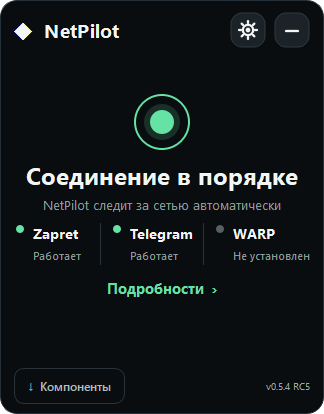
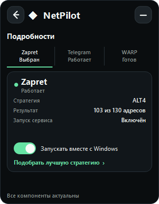
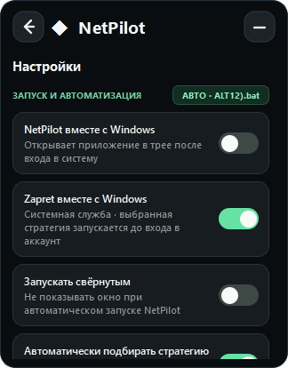

  

<h1 align="center">NetPilot</h1>

  Compact Windows control for Zapret, Telegram Proxy and Cloudflare WARP. 
  Компактное управление Zapret, Telegram Proxy и Cloudflare WARP для Windows.

<a href="#русский">Русский</a> · <a href="#english">English</a>

  
  
  

> [!IMPORTANT]
> NetPilot 0.5.4-rc6 is a release candidate. Windows networking drivers, UAC prompts and service behavior can differ between systems; review the release notes before installation.

---

# Русский

NetPilot объединяет три сетевых инструмента в одном компактном приложении и значке трея:

- **Zapret** — запуск стратегии, проверка конфигураций и автозапуск как службы Windows.
- **Telegram Proxy** — встроенный консольный прокси без второго значка в трее.
- **Cloudflare WARP** — установка официального клиента и управление через <code>warp-cli</code>.

NetPilot отдельно показывает собственный и подтверждённый внешний Zapret. Внешние процессы, службы и задания изменяются только после явного подтверждения; системные запросы UAC всегда остаются видимыми.

## Интерфейс

| Главный экран | Подробности | Настройки |
|---|---|---|
|  |  |  |

Интерфейс 0.5.4-rc6. Рабочие состояния показаны для демонстрации.

## Как это работает

1. NetPilot в фоне проверяет установленные компоненты, процессы, службы и задания Zapret и показывает фактическое состояние на главном экране и в трее.
2. Для Zapret можно запустить выбранную стратегию сразу либо сравнить доступные конфигурации по HTTPS-доступности и задержке.
3. Лучшая стратегия применяется автоматически; Telegram Proxy и WARP управляются независимо.
4. После успешного ручного подбора NetPilot предлагает запускать выбранную стратегию вместе с Windows; автоматическая проверка не открывает это предложение и не вызывает UAC.
5. При отмене или ошибке теста NetPilot пытается вернуть предыдущую стратегию, которой управлял сам.

Все потенциально системные действия — установка драйвера, WARP или службы Zapret — выполняются только через видимый запрос UAC.

## Что умеет NetPilot

### Zapret

- Загружает официальный релиз [Flowseal/zapret-discord-youtube](https://github.com/Flowseal/zapret-discord-youtube).
- Запускает выбранный <code>general*.bat</code> без отдельной консоли.
- Различает собственный, внешний, множественный и частично остановленный Zapret по пути, аргументам и структуре установки; одного имени <code>winws.exe</code> недостаточно.
- Может остановить все подтверждённые экземпляры Zapret, не удаляя внешние файлы и общие драйверы.
- Передаёт выбранную стратегию службе NetPilot транзакционно: сохраняет заменяемую конфигурацию, повторно проверяет состояние после UAC и откатывает изменения при ошибке.
- Обычное удаление службы по-прежнему затрагивает только службу, принадлежащую NetPilot.
- Сохраняет пользовательские списки и активные fake-файлы при обновлении.

### Подбор стратегии

- Читает реальные списки Flowseal и <code>utils/targets.txt</code>.
- Проверяет HTTPS через системный curl: HTTP/1.1, TLS 1.2 и TLS 1.3, где они поддерживаются.
- Сначала учитывает число доступных адресов, затем задержку ответа.
- Автоматически применяет победившую стратегию.
- После успешного ручного подбора один раз за сеанс предлагает включить автозапуск победителя.
- Раз в 15 минут выполняет лёгкую фоновую проверку восьми адресов, не перезапуская Zapret.
- После двух неудачных проверок автоматически сравнивает стратегии, если Zapret запущен самим NetPilot, приложение уже имеет права администратора и нет конфликтующей службы или WARP.
- При ошибке или отмене пытается восстановить предыдущую NetPilot-стратегию.
- Не тестирует конфигурации при обнаружении сторонней службы Zapret или чужого <code>winws.exe</code>.

Откат компонента — это не откат стратегии. При обновлении NetPilot сохраняет установленную папку Zapret как резервную копию. Команда **Вернуть Zapret до обновления** заменяет текущую папку этой копией; до первого обновления откатывать нечего.

> [!NOTE]
> Успешный HTTPS-тест не гарантирует работу Discord Voice, видеопотоков, игр или UDP/QUIC. Это проверка веб-доступности, а не полный сетевой тест.

### Telegram Proxy

- Использует закреплённую проверенную версию [Flowseal/tg-ws-proxy](https://github.com/Flowseal/tg-ws-proxy).
- Работает как дочерний консольный процесс без отдельного значка в трее.
- Ожидает порт <code>127.0.0.1:1443</code>, затем открывает официальный <code>tg://proxy</code>-адрес.
- Хранит MTProto-секрет только в локальных настройках.
- Не меняет Telegram Desktop без подтверждения пользователя.

### Cloudflare WARP

- Устанавливает официальный пакет <code>Cloudflare.Warp</code> через winget.
- Использует штатный <code>warp-cli</code> для подключения и проверки состояния.
- Не подтверждает UAC и запросы драйверов автоматически.

### Трей и настройки

- Левый клик открывает компактное окно возле области уведомлений.
- Контекстное меню содержит быстрые действия и подбор стратегии.
- Значок меняется по состоянию: серый — ожидание, зелёный — есть активные подключения, янтарный — выполняется операция, красный — требуется внимание.
- Контурные иконки и переключатели анимируются только во время реального перехода состояния; сворачивание и восстановление окна не затрагивают сетевые процессы.
- Три точки под знаком показывают число активных компонентов; точные состояния доступны в подсказке и контекстном меню.
- Автозапуск NetPilot и автозапуск Zapret являются разными настройками.
- Поддерживаются запуск свёрнутым и автоматические обновления компонентов.

  
  
  
  

## Установка

Требования: **Windows 10/11 x64**.

1. Откройте [последний релиз NetPilot](https://github.com/SxnCHeZzz/NetPilot/releases).
2. Выберите:
   - **NetPilot-0.5.4-rc6-Setup.exe** — обычная установка;
   - **NetPilot-0.5.4-rc6-Portable.zip** — портативная версия.
3. При необходимости сверьте SHA-256 с файлом **SHA256SUMS.txt**.
4. Запустите NetPilot и установите компоненты через встроенный мастер.

Установщик не требует административных прав. UAC появляется только для WinDivert, WARP или службы Zapret.

Сборки RC6 пока не подписаны коммерческим сертификатом, поэтому Windows SmartScreen может показать предупреждение. Загружайте файлы только со страницы Releases и сверяйте SHA-256 перед запуском.

## Первый запуск

1. Откройте **Компоненты**.
2. Выберите каталог без кириллицы и пробелов, например <code>C:\NetPilotComponents</code>.
3. Установите Zapret и, при необходимости, WARP.
4. Нажмите **Подобрать стратегию**.
5. Оставьте победившую стратегию активной или включите **Zapret вместе с Windows**.

Telegram Proxy уже входит в сборку.

## Zapret вместе с Windows

Переключатель устанавливает выбранную стратегию как службу <code>AUTO_START</code>.

- UAC запрашивается при создании или удалении службы.
- Служба запускается независимо от окна NetPilot.
- Если обнаружен внешний Zapret, NetPilot заранее показывает подтверждение, останавливает только подтверждённые объекты и сохраняет исходный автозапуск для отдельного восстановления.
- Конфликтующая служба с именем <code>zapret</code> заменяется только в рамках подтверждённой транзакции; другие внешние службы и задания не удаляются, а их автозапуск отключается обратимо.
- При неуспешной передаче NetPilot пытается вернуть точную сохранённую конфигурацию и проверяет результат. Восстановление, которое Windows не подтвердила, не выдаётся за успешное.

Проверка:

~~~powershell
sc.exe query zapret
sc.exe qc zapret
~~~

Ожидаемые признаки: <code>RUNNING</code>, <code>AUTO_START</code>, путь к <code>winws.exe</code> и аргументы стратегии.

## Полная остановка Zapret

Действие **Остановить весь Zapret** появляется только при подтверждённой активности:

- **Остановить сейчас** завершает подтверждённые службы, задания и процессы, не меняя их автозапуск.
- **Остановить и отключить автозапуск** сначала сохраняет текущие режимы служб/заданий, затем отключает их перезапуск и останавливает Zapret.
- **Восстановить внешний автозапуск Zapret** появляется в настройках, пока сохранённые записи не восстановлены и не проверены.

Неоднозначные процессы не останавливаются автоматически. Отмена UAC ничего не изменяет. Если служба исчезла, была перенастроена другим приложением или её учётную запись нельзя безопасно восстановить, NetPilot сохраняет запись для ручной проверки вместо заявления об успехе.

## Безопасность и данные

- Нет телеметрии и внешней аналитики.
- Настройки, журналы, Telegram-секрет и тесты находятся в <code>%LOCALAPPDATA%\NetPilot</code>.
- Загрузки ограничены ожидаемыми файлами и разрешёнными GitHub-хостами.
- Архивы проверяются на небезопасные пути, ссылки и чрезмерный размер.
- SHA-256 проверяется, если digest опубликован в upstream-релизе.
- UAC всегда остаётся видимым.
- Пользовательские списки Flowseal сохраняются при обновлении.

## Устранение проблем

| Проблема | Что проверить |
|---|---|
| Zapret не запускается | Подтвердите UAC. Проверьте <code>bin\winws.exe</code>, WinDivert и антивирус. |
| Обнаружена внешняя служба Zapret | Откройте **Подробности** для полной остановки либо подтвердите передачу выбранной стратегии службе NetPilot. |
| WinError 10013 | Проверьте брандмауэр, антивирус, прокси и сетевые разрешения. |
| Telegram не подключился | Подтвердите <code>tg://proxy</code> или добавьте <code>127.0.0.1:1443</code> вручную. |
| Порт 1443 занят | Закройте старый <code>TgWsProxy_windows.exe</code> через его приложение. |
| WARP не найден | Установите App Installer/winget и повторите установку. |
| Результаты нестабильны | Отключите WARP, VPN и другие обходчики, затем повторите тест. |
| HTTPS работает, а голос или видео — нет | Тест не проверяет UDP, звонки и медиапотоки. Попробуйте другую стратегию. |

## Разработка

~~~powershell
git clone <repository-url>
cd NetPilot
python -m pip install -r requirements.txt
python -m unittest discover -s tests -v
python src\app.py
~~~

Сборка:

~~~powershell
python -m PyInstaller --clean --noconfirm --onedir --windowed --name NetPilot --icon assets\netpilot.ico --add-data "assets;assets" --collect-all proxy --collect-all utils --paths src src\app.py
~~~

Установщик через Inno Setup 6:

~~~powershell
& "C:\Program Files (x86)\Inno Setup 6\ISCC.exe" installer\NetPilot.iss
~~~

GitHub Actions выполняет тесты, собирает приложение, установщик и портативный ZIP при ручном запуске или публикации тега <code>v*</code>.

## Структура

~~~text
src/                 интерфейс, компоненты и сетевые проверки
assets/              значки и доменные списки
docs/screenshots/     изображения документации
installer/           Inno Setup
tests/               модульные и offscreen UI-тесты
.github/workflows/   Windows CI и сборка
~~~

## Ограничения RC

- Драйверы, установщик, WARP и UAC требуют проверки на реальной Windows.
- Автоматическое фоновое восстановление внешних служб не выполняется: восстановление запускается пользователем и проверяется после UAC.
- Подбор стратегии создаёт много HTTPS-запросов и может занимать несколько минут.
- Полное управление всеми параметрами upstream <code>service.bat</code> пока не реализовано.
- NetPilot не связан с Flowseal или Cloudflare.

## Лицензия

NetPilot распространяется по лицензии [MIT](LICENSE).

- Zapret: [Flowseal/zapret-discord-youtube](https://github.com/Flowseal/zapret-discord-youtube)
- Telegram Proxy: [Flowseal/tg-ws-proxy](https://github.com/Flowseal/tg-ws-proxy)
- Cloudflare WARP: [официальный сайт](https://one.one.one.one/)

Сторонние уведомления: [THIRD_PARTY_NOTICES.txt](THIRD_PARTY_NOTICES.txt).

---

# English

NetPilot combines three network tools in one compact tray application:

- **Zapret** — strategy launch, configuration testing and Windows service startup.
- **Telegram Proxy** — a bundled console proxy without another tray icon.
- **Cloudflare WARP** — official client installation and <code>warp-cli</code> control.

NetPilot reports its own and confirmed external Zapret instances separately. External processes, services and tasks are changed only after explicit consent, and native Windows UAC prompts remain visible.

## Interface

| Home | Details | Settings |
|---|---|---|
|  |  |  |

NetPilot 0.5.4-rc6. Working states are shown for demonstration.

## How it works

1. NetPilot checks installed components plus Zapret processes, services and scheduled tasks in the background, then reports the factual state in the main window and tray.
2. Zapret can run a selected strategy immediately or compare available configurations by HTTPS reachability and latency.
3. The best strategy is applied automatically; Telegram Proxy and WARP remain independently controlled.
4. After a successful manual comparison, NetPilot offers Windows startup for the selected strategy; automatic checks never show this offer or trigger UAC.
5. If testing is cancelled or fails, NetPilot attempts to restore the previous strategy that it managed.

Every system-level action — installing a driver, WARP or the Zapret service — requires a visible UAC prompt.

## Features

### Zapret

- Downloads the official [Flowseal/zapret-discord-youtube](https://github.com/Flowseal/zapret-discord-youtube) release.
- Starts the selected <code>general*.bat</code> without another console window.
- Distinguishes managed, external, multiple and partially stopped Zapret from paths, arguments and installation structure; the name <code>winws.exe</code> alone is never enough.
- Can stop every confirmed Zapret instance without deleting external files or shared drivers.
- Transfers the selected strategy to the NetPilot service transactionally: it saves replaced configuration, revalidates after UAC and rolls back on failure.
- Ordinary service removal still affects only a service owned by NetPilot.
- Preserves custom lists and active fake files during updates.

### Strategy selection

- Reads the installed Flowseal lists and <code>utils/targets.txt</code>.
- Checks HTTPS with system curl using HTTP/1.1, TLS 1.2 and TLS 1.3 where available.
- Prioritizes reachable targets, then latency.
- Automatically applies the winning strategy.
- Offers Windows startup for a successful manual winner once per app session.
- Runs a lightweight eight-address health sample every 15 minutes without restarting Zapret.
- After two failed samples, automatically compares strategies when Zapret is owned by NetPilot, the app is already elevated, and neither a conflicting service nor WARP is active.
- Attempts to restore the previous managed strategy after failure or cancellation.
- Refuses to test while an unrelated service or <code>winws.exe</code> is present.

Component rollback is separate from strategy rollback. During an update, NetPilot keeps the installed Zapret folder as a backup. **Restore Zapret from before the update** replaces the current folder with that backup; no rollback is available before the first update.

> [!NOTE]
> A successful HTTPS test does not guarantee Discord Voice, streaming, games or UDP/QUIC. It is a web-reachability check.

### Telegram Proxy

- Uses a pinned, reviewed [Flowseal/tg-ws-proxy](https://github.com/Flowseal/tg-ws-proxy) version.
- Runs as a child process without another tray icon.
- Waits for <code>127.0.0.1:1443</code>, then opens the official <code>tg://proxy</code> link.
- Stores the MTProto secret only in local user settings.
- Does not silently change Telegram Desktop.

### Cloudflare WARP

- Installs the official <code>Cloudflare.Warp</code> package through winget.
- Uses <code>warp-cli</code> for connection and status.
- Never accepts UAC or driver prompts automatically.

### Tray and preferences

- Left click opens the compact notification-area flyout.
- The context menu provides quick actions and strategy testing.
- The icon reflects current state: gray means idle, green means connected, amber means an operation is running, and red requires attention.
- Vector icons and toggles animate only during a real state transition; minimizing or restoring the window never touches network processes.
- Three dots below the mark show the number of active components; exact states are available in the tooltip and context menu.
- Starting NetPilot and starting Zapret with Windows are separate settings.
- Tray startup and automatic component updates are supported.

  
  
  
  

## Installation

Requirement: **Windows 10/11 x64**.

1. Open the [latest NetPilot release](https://github.com/SxnCHeZzz/NetPilot/releases).
2. Choose:
   - **NetPilot-0.5.4-rc6-Setup.exe** for installation;
   - **NetPilot-0.5.4-rc6-Portable.zip** for portable use.
3. Optionally verify SHA-256 values against **SHA256SUMS.txt**.
4. Start NetPilot and install components through the setup flow.

The installer does not require administrator rights. UAC appears only for WinDivert, WARP or the Zapret service.

RC6 builds are not yet signed with a commercial certificate, so Windows SmartScreen may display a warning. Download only from the Releases page and verify the SHA-256 value before running a file.

## First run

1. Open **Components**.
2. Select a path without spaces or non-ASCII characters, such as <code>C:\NetPilotComponents</code>.
3. Install Zapret and, if needed, WARP.
4. Select **Find best strategy**.
5. Keep the winner active or enable **Zapret with Windows**.

Telegram Proxy is bundled.

## Zapret with Windows

The switch installs the selected strategy as an <code>AUTO_START</code> service.

- UAC is requested when the service is created or removed.
- The service starts independently of the NetPilot window.
- When external Zapret is present, NetPilot explains the transfer first, stops only confirmed objects and saves original startup settings for separate restoration.
- A conflicting service named <code>zapret</code> is replaced only inside the confirmed transaction. Other external services and tasks are not deleted; their startup is disabled reversibly.
- If transfer fails, NetPilot attempts to restore the exact saved configuration and verifies the result. Windows state that cannot be verified is never reported as restored.

Verify:

~~~powershell
sc.exe query zapret
sc.exe qc zapret
~~~

Expected properties include <code>RUNNING</code>, <code>AUTO_START</code>, the <code>winws.exe</code> path and strategy arguments.

## Stopping all Zapret instances

**Stop all Zapret** is visible only while confirmed activity exists:

- **Stop now** stops confirmed services, tasks and processes without changing startup settings.
- **Stop and disable automatic restart** saves current service/task modes first, disables restart and then stops Zapret.
- **Restore external Zapret startup** remains available in Settings while saved entries still require verified restoration.

Ambiguous processes are never stopped automatically. Cancelling UAC changes nothing. If another app removes or reconfigures a service, or its account cannot be restored safely, NetPilot retains the recovery record for manual review instead of claiming success.

## Security and local data

- No telemetry or external analytics.
- Settings, logs, Telegram secret and test results stay under <code>%LOCALAPPDATA%\NetPilot</code>.
- Downloads are restricted to expected files on allowed GitHub hosts.
- Archives are checked for unsafe paths, links and excessive size.
- SHA-256 is verified when the upstream release publishes a digest.
- Native UAC prompts remain visible.
- Flowseal custom lists are preserved during updates.

## Troubleshooting

| Problem | What to check |
|---|---|
| Zapret does not start | Accept UAC. Check <code>bin\winws.exe</code>, WinDivert and antivirus blocks. |
| An external Zapret service was detected | Open **Details** to stop all confirmed instances or explicitly transfer the selected strategy to NetPilot. |
| WinError 10013 | Check firewall, antivirus, proxy and network permissions. |
| Telegram did not connect | Confirm <code>tg://proxy</code> or add <code>127.0.0.1:1443</code> manually. |
| Port 1443 is occupied | Close the older <code>TgWsProxy_windows.exe</code> through its own app. |
| WARP is missing | Install App Installer/winget and retry. |
| Results vary | Disconnect WARP, VPNs and other bypass tools, then rerun the test. |
| HTTPS passes but voice/video fails | The test does not cover UDP, calls or media streams. Try another strategy. |

## Development

~~~powershell
git clone <repository-url>
cd NetPilot
python -m pip install -r requirements.txt
python -m unittest discover -s tests -v
python src\app.py
~~~

Build:

~~~powershell
python -m PyInstaller --clean --noconfirm --onedir --windowed --name NetPilot --icon assets\netpilot.ico --add-data "assets;assets" --collect-all proxy --collect-all utils --paths src src\app.py
~~~

Create the installer with Inno Setup 6:

~~~powershell
& "C:\Program Files (x86)\Inno Setup 6\ISCC.exe" installer\NetPilot.iss
~~~

GitHub Actions runs tests and creates the app, installer and portable ZIP for manual runs and <code>v*</code> tags.

## Project layout

~~~text
src/                 UI, components and network checks
assets/              icons and domain profiles
docs/screenshots/     documentation images
installer/           Inno Setup
tests/               unit and offscreen UI tests
.github/workflows/   Windows CI and packaging
~~~

## Release-candidate limitations

- Drivers, installer behavior, WARP and UAC require real Windows testing.
- External services are never restored silently in the background; restoration is user-initiated and verified after UAC.
- Strategy comparison can issue many HTTPS requests and may take several minutes.
- Full management of every upstream <code>service.bat</code> option is not implemented.
- NetPilot is not affiliated with Flowseal or Cloudflare.

## License

NetPilot is distributed under the [MIT License](LICENSE).

- Zapret: [Flowseal/zapret-discord-youtube](https://github.com/Flowseal/zapret-discord-youtube)
- Telegram Proxy: [Flowseal/tg-ws-proxy](https://github.com/Flowseal/tg-ws-proxy)
- Cloudflare WARP: [official website](https://one.one.one.one/)

Third-party notices: [THIRD_PARTY_NOTICES.txt](THIRD_PARTY_NOTICES.txt).
